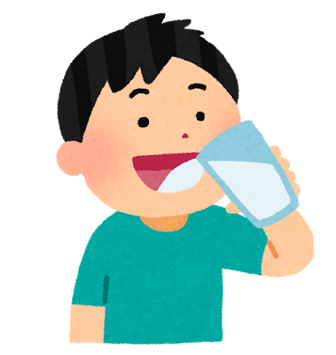

<!-- _class: lead story-title -->

分散型SNSのすゝめ

# 自分の「好き」を 楽しめる場所を見つけよう

まっちゃてぃー。 / 三田学園文化祭LT会

<!--
0〜2分。TwitterやInstagramは使うけれど分散型SNSは初めて、という方に向けて話します。好きな話をできる場所をひとつ持ち帰ってほしい。
-->

---

<!-- _class: story profile-slide -->

# 皆さんはじめまして 

まっちゃてぃー。

SNS（が好き）な人

趣味：コーディング、SNS

Misskeyの開発に参加 SNS「まっちゃすきー。」の運営

@mattyatea

<!--
表紙の次に30〜40秒ほどで自己紹介します。
皆さん、はじめまして。まっちゃてぃー。です。
過去の自己紹介でも「SNS（が好き）な人」と書いているくらい、SNSが好きです。
趣味はコーディングとSNSで、Misskeyの開発に参加したり、「まっちゃすきー。」というSNSを運営したりしています。
今日は使う側として、好きなことを楽しめる場所の話をします。
自己紹介を含めて導入は約2分に収めます。
「本番環境のDBを吹き飛ばした話」2〜4ページと「タイトルページ」2ページを参考にしています。
アイコンは前者の2ページから取り出した本人の既存素材です。
過去の学年・利用者数・投稿数は現在の情報として流用しません。
-->

---

<!-- _class: statement -->

# なんといっても SNSが大好き

<!--
本人の過去の発表にある言い方。SNSの開発や運営にも関わっていることを短く添えます。
-->

---

<!-- _class: story -->

みなさん、 TwitterとかInstagram 使ってますよね。

<!--
元資料の問いかけと、右側に画面を置く構図を踏襲。今日はSNSを普段使っている方に話しかけます。
-->

---

<!-- _class: story -->

# SNSってこういうのが楽しい

<figure class=""><figcaption>ゲームの話</figcaption></figure><figure class="waiting"><figcaption>創作を見せる</figcaption></figure><figure class="waiting"><figcaption>日常を共有する</figcaption></figure>

<!--
同じ位置にイラストを一つずつ増やします。ゲームの話、作ったものを見せる、日常の写真。みなさんは何を楽しんでますか？三枚合わせて約45秒。
-->

---

<!-- _class: story -->

# SNSってこういうのが楽しい

<figure class=""><figcaption>ゲームの話</figcaption></figure><figure class=""><figcaption>創作を見せる</figcaption></figure><figure class="waiting"><figcaption>日常を共有する</figcaption></figure>

<!--
同じ位置にイラストを一つずつ増やします。ゲームの話、作ったものを見せる、日常の写真。みなさんは何を楽しんでますか？三枚合わせて約45秒。
-->

---

<!-- _class: story -->

# SNSってこういうのが楽しい

<figure class=""><figcaption>ゲームの話</figcaption></figure><figure class=""><figcaption>創作を見せる</figcaption></figure><figure class=""><figcaption>日常を共有する</figcaption></figure>

<!--
同じ位置にイラストを一つずつ増やします。ゲームの話、作ったものを見せる、日常の写真。みなさんは何を楽しんでますか？三枚合わせて約45秒。
-->

---

<!-- _class: statement -->

好きなことって...

# もっと話したいし いろんな人と語り合いたい

<!-- 5〜7枚目の「楽しい」を受けて、聞き手に共感してもらうページ。自分が好きなことって、もっと積極的に話したいし、いろんな人と語り合いたいよね。 -->

---

<!-- _class: story everyday -->

# でも いつものSNSだと...

<figure class="viewer"><figcaption>ゲーム好き</figcaption></figure>

いつものSNS

<b>ニュース</b><small>いま</small>

【速報】今日の天気は…

<b>おすすめ</b><small>いま</small>

PR 今だけ半額！

<b>まとめ</b><small>いま</small>

買ってよかったもの10選リンクから

<!-- ニュースだったり、PRだったり、アフィリエイトだったりがたくさん流れてくる。ゲームの話をしている人が見当たらない。 -->

---

<!-- _class: statement -->

ゲームの話がしたいのに...

# 同じ趣味の人が なかなか見つからない

<!-- 今のSNSは何でも流れてくる場所。好きな話をしている人を自分で探すのが大変。 -->

---

<!-- _class: statement -->

しかも...

# 流れてくる話に 疲れること ありませんか？

<!-- 聞き手への問いかけ。ニュースや広告、知らない人の話がずっと流れてくると、好きな話をしに来たのに疲れてしまう。 -->

---

<!-- _class: story everyday -->

# こういうの 見たくないのに流れてくる...

<figure class="viewer"><figcaption>ゲーム好き</figcaption></figure>

いつものSNS

<b>ニュース</b><small>いま</small>

【速報】来月からまた値上げ

<b>まとめ</b><small>いま</small>

【ネタバレ】新作のラスボスの正体は…

<b>知らない人</b><small>いま</small>

そのゲームってもうオワコンでしょ

<!-- 見たくないニュースや話が流れてきて嫌だよね、と共感してもらう。値上げのニュース、まだ遊んでいないゲームのネタバレ、好きなものを悪く言う投稿。どれも架空の投稿例。 -->

---

<!-- _class: statement question-beat -->

じゃあ もし...

# 好きな話だけできる 「別荘」があったら？

<!-- ここで少し間を置く。いつものSNSはそのままで、疲れたときや好きな話をしたいときに行ける場所。この「別荘」という言い方を最後まで使います。 -->

---

<!-- _class: story everyday -->

# たとえば ゲーム好きが集まるSNSなら

<figure class="viewer"><figcaption>ゲーム好き</figcaption></figure>

ゲーム好きのSNS

<b>ゆう</b><small>いま</small>

新作の発売日きまった〜！みんな買う？

<b>みお</b><small>いま</small>

ネタバレなしで言うと… ラスト最高だった

<b>はると</b><small>いま</small>

3時間かかったけど ボス倒せた〜！！

<!-- 流れてくるのがゲームの話だけ。さっきのネタバレと違って、ここでは「ネタバレなしで」と気をつかってくれる。楽しそうと思ってもらう。投稿は架空の例。 -->

---

<!-- _class: story -->

# 別荘って 好きな場所に建てますよね

<figure class="">

<figcaption>海が好きなら 海沿いに</figcaption></figure><figure class="">

<figcaption>自然が好きなら 山の中に</figcaption></figure><figure class="">

<figcaption>温泉が好きなら 温泉地に</figcaption></figure>

<!-- 別荘のたとえを広げる。海を見るのが好きだから海沿いに建てるし、自然が好きなら山の中にも建てる。好きなものが多ければ、いろんなところに別荘を持つよね。 -->

---

<!-- _class: story -->

# SNSの別荘も 好きなことごとに

<figure class=""><figcaption>ゲームが好きなら ゲーム好きのSNSに</figcaption></figure><figure class=""><figcaption>絵が好きなら お絵かき好きのSNSに</figcaption></figure><figure class=""><figcaption>写真が好きなら 写真好きのSNSに</figcaption></figure>

<!-- 前のページと同じ並びで、海や山がSNSに変わる。好きなことが多かったら、別荘はそれぞれ持てばいい。アカウントが増えることは問題にしない。 -->

---

<!-- _class: story geography -->

たとえば

# AさんとBさんがいます

<b>Aさん</b>ゲームも絵も好き ゲームとお絵かきのSNSに別荘

<b>Bさん</b>ゲームが好き ゲームのSNSに別荘

<!-- 先に人物を紹介する。Aさんはクリエイターで、ゲームもするし絵も描く。ゲームの話はゲーム好きのSNS、絵はお絵かき好きのSNSと、ちゃんと使い分けている。Bさんはゲーム好きのSNSだけ。 -->

---

<!-- _class: statement -->

AさんとBさんは ゲーム仲間

# ゲームの話は ゲーム好きのSNSで

---

<!-- _class: story everyday solo-story -->

# Aさんの画面

<figure class="viewer"><figcaption><b>Aさん</b>の画面</figcaption></figure>

ゲーム好きのSNS

<b>Aさん</b><small>いま</small>

やっとボス倒せた〜！！

<svg aria-hidden="true" data-icon="arrow-back-up" xmlns="http://www.w3.org/2000/svg" width="24" height="24" viewBox="0 0 24 24" fill="none" stroke="currentColor" stroke-width="2" stroke-linecap="round" stroke-linejoin="round" > <path d="M9 14l-4 -4l4 -4" /> <path d="M5 10h11a4 4 0 1 1 0 8h-1" /> </svg><svg aria-hidden="true" data-icon="repeat" xmlns="http://www.w3.org/2000/svg" width="24" height="24" viewBox="0 0 24 24" fill="none" stroke="currentColor" stroke-width="2" stroke-linecap="round" stroke-linejoin="round" > <path d="M4 12v-3a3 3 0 0 1 3 -3h13m-3 -3l3 3l-3 3" /> <path d="M20 12v3a3 3 0 0 1 -3 3h-13m3 3l-3 -3l3 -3" /> </svg><svg aria-hidden="true" data-icon="plus" xmlns="http://www.w3.org/2000/svg" width="24" height="24" viewBox="0 0 24 24" fill="none" stroke="currentColor" stroke-width="2" stroke-linecap="round" stroke-linejoin="round" > <path d="M12 5l0 14" /> <path d="M5 12l14 0" /> </svg><svg aria-hidden="true" data-icon="dots" xmlns="http://www.w3.org/2000/svg" width="24" height="24" viewBox="0 0 24 24" fill="none" stroke="currentColor" stroke-width="2" stroke-linecap="round" stroke-linejoin="round" > <path d="M4 12a1 1 0 1 0 2 0a1 1 0 1 0 -2 0" /> <path d="M11 12a1 1 0 1 0 2 0a1 1 0 1 0 -2 0" /> <path d="M18 12a1 1 0 1 0 2 0a1 1 0 1 0 -2 0" /> </svg>

<!-- Aさんの投稿一覧。画面にある内容だけを説明し、次のページの答えは先に言わない。 -->

---

<!-- _class: story everyday solo-story -->

# フォローしているBさんにも出てきます

<figure class="viewer"><figcaption><b>Bさん</b>の画面</figcaption></figure>

ゲーム好きのSNS

<b>Aさん</b><small>いま</small>

やっとボス倒せた〜！！

<svg aria-hidden="true" data-icon="arrow-back-up" xmlns="http://www.w3.org/2000/svg" width="24" height="24" viewBox="0 0 24 24" fill="none" stroke="currentColor" stroke-width="2" stroke-linecap="round" stroke-linejoin="round" > <path d="M9 14l-4 -4l4 -4" /> <path d="M5 10h11a4 4 0 1 1 0 8h-1" /> </svg><svg aria-hidden="true" data-icon="repeat" xmlns="http://www.w3.org/2000/svg" width="24" height="24" viewBox="0 0 24 24" fill="none" stroke="currentColor" stroke-width="2" stroke-linecap="round" stroke-linejoin="round" > <path d="M4 12v-3a3 3 0 0 1 3 -3h13m-3 -3l3 3l-3 3" /> <path d="M20 12v3a3 3 0 0 1 -3 3h-13m3 3l-3 -3l3 -3" /> </svg><svg aria-hidden="true" data-icon="plus" xmlns="http://www.w3.org/2000/svg" width="24" height="24" viewBox="0 0 24 24" fill="none" stroke="currentColor" stroke-width="2" stroke-linecap="round" stroke-linejoin="round" > <path d="M12 5l0 14" /> <path d="M5 12l14 0" /> </svg><svg aria-hidden="true" data-icon="dots" xmlns="http://www.w3.org/2000/svg" width="24" height="24" viewBox="0 0 24 24" fill="none" stroke="currentColor" stroke-width="2" stroke-linecap="round" stroke-linejoin="round" > <path d="M4 12a1 1 0 1 0 2 0a1 1 0 1 0 -2 0" /> <path d="M11 12a1 1 0 1 0 2 0a1 1 0 1 0 -2 0" /> <path d="M18 12a1 1 0 1 0 2 0a1 1 0 1 0 -2 0" /> </svg>

<!-- Bさんのホーム。画面にある内容だけを説明し、次のページの答えは先に言わない。 -->

---

<!-- _class: story everyday -->

# でも ゲーム仲間とは ゲーム以外の話もしたい

<figure class="viewer"><figcaption><b>Bさん</b></figcaption></figure>

ゲーム仲間との雑談

「Aさんの絵 また見たいな」

「今日の空きれいだった」

「週末どこか行った？」

<!-- ゲーム仲間とはゲームの話をしたい。でもゲーム以外の話もしたいことがある。BさんはAさんとゲームを一緒にやっていて、Aさんの絵も好き。投稿は架空の例。 -->

---

<!-- _class: story everyday solo-story -->

# でも Aさんの絵は お絵かきの別荘に

<figure class="viewer"><figcaption><b>Aさん</b>の画面</figcaption></figure>

お絵かき好きのSNS

<b>Aさん</b><small>いま</small>

今日描いた絵、見て〜！

<svg aria-hidden="true" data-icon="arrow-back-up" xmlns="http://www.w3.org/2000/svg" width="24" height="24" viewBox="0 0 24 24" fill="none" stroke="currentColor" stroke-width="2" stroke-linecap="round" stroke-linejoin="round" > <path d="M9 14l-4 -4l4 -4" /> <path d="M5 10h11a4 4 0 1 1 0 8h-1" /> </svg><svg aria-hidden="true" data-icon="repeat" xmlns="http://www.w3.org/2000/svg" width="24" height="24" viewBox="0 0 24 24" fill="none" stroke="currentColor" stroke-width="2" stroke-linecap="round" stroke-linejoin="round" > <path d="M4 12v-3a3 3 0 0 1 3 -3h13m-3 -3l3 3l-3 3" /> <path d="M20 12v3a3 3 0 0 1 -3 3h-13m3 3l-3 -3l3 -3" /> </svg><svg aria-hidden="true" data-icon="plus" xmlns="http://www.w3.org/2000/svg" width="24" height="24" viewBox="0 0 24 24" fill="none" stroke="currentColor" stroke-width="2" stroke-linecap="round" stroke-linejoin="round" > <path d="M12 5l0 14" /> <path d="M5 12l14 0" /> </svg><svg aria-hidden="true" data-icon="dots" xmlns="http://www.w3.org/2000/svg" width="24" height="24" viewBox="0 0 24 24" fill="none" stroke="currentColor" stroke-width="2" stroke-linecap="round" stroke-linejoin="round" > <path d="M4 12a1 1 0 1 0 2 0a1 1 0 1 0 -2 0" /> <path d="M11 12a1 1 0 1 0 2 0a1 1 0 1 0 -2 0" /> <path d="M18 12a1 1 0 1 0 2 0a1 1 0 1 0 -2 0" /> </svg>

<!-- Aさんは絵をお絵かき好きのSNSに投稿して、ちゃんと使い分けている。でもAさんも、ゲーム仲間に「いいから見てよ」と絵を見てほしい。画面にある内容だけを説明し、次のページの答えは先に言わない。 -->

---

<!-- _class: statement question-beat -->

この絵を見るには...

# Bさんも そこに 別荘を建てなきゃだめ？

<!-- この問いで止める。他の人の別荘を見るために、その別荘地に自分も家を建てなきゃいけないのか。聞き手が考えてから次の画面へ進む。 -->

---

<!-- _class: story everyday solo-story -->

# 建てなくても Bさんの画面に届きます

<figure class="viewer"><figcaption><b>Bさん</b>の画面</figcaption></figure>

ゲーム好きのSNS

<b>Aさん</b><small>いま</small>

今日描いた絵、見て〜！

<svg aria-hidden="true" data-icon="arrow-back-up" xmlns="http://www.w3.org/2000/svg" width="24" height="24" viewBox="0 0 24 24" fill="none" stroke="currentColor" stroke-width="2" stroke-linecap="round" stroke-linejoin="round" > <path d="M9 14l-4 -4l4 -4" /> <path d="M5 10h11a4 4 0 1 1 0 8h-1" /> </svg><svg aria-hidden="true" data-icon="repeat" xmlns="http://www.w3.org/2000/svg" width="24" height="24" viewBox="0 0 24 24" fill="none" stroke="currentColor" stroke-width="2" stroke-linecap="round" stroke-linejoin="round" > <path d="M4 12v-3a3 3 0 0 1 3 -3h13m-3 -3l3 3l-3 3" /> <path d="M20 12v3a3 3 0 0 1 -3 3h-13m3 3l-3 -3l3 -3" /> </svg><svg aria-hidden="true" data-icon="plus" xmlns="http://www.w3.org/2000/svg" width="24" height="24" viewBox="0 0 24 24" fill="none" stroke="currentColor" stroke-width="2" stroke-linecap="round" stroke-linejoin="round" > <path d="M12 5l0 14" /> <path d="M5 12l14 0" /> </svg><svg aria-hidden="true" data-icon="dots" xmlns="http://www.w3.org/2000/svg" width="24" height="24" viewBox="0 0 24 24" fill="none" stroke="currentColor" stroke-width="2" stroke-linecap="round" stroke-linejoin="round" > <path d="M4 12a1 1 0 1 0 2 0a1 1 0 1 0 -2 0" /> <path d="M11 12a1 1 0 1 0 2 0a1 1 0 1 0 -2 0" /> <path d="M18 12a1 1 0 1 0 2 0a1 1 0 1 0 -2 0" /> </svg>

<!-- BさんのSNSには登録済みでAさんをフォローしている。画面にある内容だけを説明し、次のページの答えは先に言わない。 -->

---

<!-- _class: statement -->

実は...

# SNS同士が つながれるものもあるんです

<!-- ここから、つながれるSNSでの例へ切り替える。TwitterとInstagramの直接連携ではないことは口頭で伝える。 -->

---

<!-- _class: statement question-beat -->

返信が届くのは想像できそう

# じゃあ いいねなどの反応は？

<!-- ここで止める。Bさんが絵に「いいね」したらAさんに届くか、聞き手に予想してもらう。 -->

---

<!-- _class: story everyday solo-story -->

# Aさんに反応が届きました

<figure class="viewer"><figcaption><b>Aさん</b>の画面</figcaption></figure>

お絵かき好きのSNS

<b>Aさん</b><small>いま</small>

今日描いた絵、見て〜！

<svg aria-hidden="true" data-icon="arrow-back-up" xmlns="http://www.w3.org/2000/svg" width="24" height="24" viewBox="0 0 24 24" fill="none" stroke="currentColor" stroke-width="2" stroke-linecap="round" stroke-linejoin="round" > <path d="M9 14l-4 -4l4 -4" /> <path d="M5 10h11a4 4 0 1 1 0 8h-1" /> </svg><svg aria-hidden="true" data-icon="repeat" xmlns="http://www.w3.org/2000/svg" width="24" height="24" viewBox="0 0 24 24" fill="none" stroke="currentColor" stroke-width="2" stroke-linecap="round" stroke-linejoin="round" > <path d="M4 12v-3a3 3 0 0 1 3 -3h13m-3 -3l3 3l-3 3" /> <path d="M20 12v3a3 3 0 0 1 -3 3h-13m3 3l-3 -3l3 -3" /> </svg><svg aria-hidden="true" data-icon="plus" xmlns="http://www.w3.org/2000/svg" width="24" height="24" viewBox="0 0 24 24" fill="none" stroke="currentColor" stroke-width="2" stroke-linecap="round" stroke-linejoin="round" > <path d="M12 5l0 14" /> <path d="M5 12l14 0" /> </svg><svg aria-hidden="true" data-icon="dots" xmlns="http://www.w3.org/2000/svg" width="24" height="24" viewBox="0 0 24 24" fill="none" stroke="currentColor" stroke-width="2" stroke-linecap="round" stroke-linejoin="round" > <path d="M4 12a1 1 0 1 0 2 0a1 1 0 1 0 -2 0" /> <path d="M11 12a1 1 0 1 0 2 0a1 1 0 1 0 -2 0" /> <path d="M18 12a1 1 0 1 0 2 0a1 1 0 1 0 -2 0" /> </svg>

<b>1</b><small>Bさんから</small>

<!-- Bさんの反応がAさんの画面に届いた。次の「もっと伝えたい」へつなぐ。 -->

---

<!-- _class: statement question-beat -->

いいねだけだと物足りない？

# もっと「すごい！」を 伝えるには？

<!-- ここで止める。答えは次の絵文字での反応。 -->

---

<!-- _class: story -->

# 絵文字でも返せます

これができるのが「Misskey」

<b>Aさん</b><small>お絵かき好きのSNS</small>
いま

今日描いた絵、見て〜！

321111

<svg aria-hidden="true" data-icon="arrow-back-up" xmlns="http://www.w3.org/2000/svg" width="24" height="24" viewBox="0 0 24 24" fill="none" stroke="currentColor" stroke-width="2" stroke-linecap="round" stroke-linejoin="round" > <path d="M9 14l-4 -4l4 -4" /> <path d="M5 10h11a4 4 0 1 1 0 8h-1" /> </svg><svg aria-hidden="true" data-icon="repeat" xmlns="http://www.w3.org/2000/svg" width="24" height="24" viewBox="0 0 24 24" fill="none" stroke="currentColor" stroke-width="2" stroke-linecap="round" stroke-linejoin="round" > <path d="M4 12v-3a3 3 0 0 1 3 -3h13m-3 -3l3 3l-3 3" /> <path d="M20 12v3a3 3 0 0 1 -3 3h-13m3 3l-3 -3l3 -3" /> </svg><svg aria-hidden="true" data-icon="plus" xmlns="http://www.w3.org/2000/svg" width="24" height="24" viewBox="0 0 24 24" fill="none" stroke="currentColor" stroke-width="2" stroke-linecap="round" stroke-linejoin="round" > <path d="M12 5l0 14" /> <path d="M5 12l14 0" /> </svg><svg aria-hidden="true" data-icon="dots" xmlns="http://www.w3.org/2000/svg" width="24" height="24" viewBox="0 0 24 24" fill="none" stroke="currentColor" stroke-width="2" stroke-linecap="round" stroke-linejoin="round" > <path d="M4 12a1 1 0 1 0 2 0a1 1 0 1 0 -2 0" /> <path d="M11 12a1 1 0 1 0 2 0a1 1 0 1 0 -2 0" /> <path d="M18 12a1 1 0 1 0 2 0a1 1 0 1 0 -2 0" /> </svg>

<!--
同じ投稿に絵文字の反応が増えます。おめでとう、すごい、好き。文字を書かなくても反応できます。すべての分散型SNSで同じ機能になるわけではありません。
-->

---

<!-- _class: statement -->

つまり...

# 好きな場所にいても いろんな人と話せる

<!--
ここから違いの説明です。TwitterとInstagramが直接つながる話ではありません。対応するSNS同士の話です。
-->

---

<!-- _class: statement -->

音楽が好きなCさんもいます

# Cさんにも 届くと思いますか？

<!--
一対一専用の仕組みではありません。同じSNSにもたくさんの人がいて、別のSNSともつながります。
-->

---

<!-- _class: story everyday solo-story -->

# Cさんも自分のSNSで読めます

音楽好きのSNS

<b>Aさん</b><small>いま</small>

今日描いた絵、見て〜！

<svg aria-hidden="true" data-icon="arrow-back-up" xmlns="http://www.w3.org/2000/svg" width="24" height="24" viewBox="0 0 24 24" fill="none" stroke="currentColor" stroke-width="2" stroke-linecap="round" stroke-linejoin="round" > <path d="M9 14l-4 -4l4 -4" /> <path d="M5 10h11a4 4 0 1 1 0 8h-1" /> </svg><svg aria-hidden="true" data-icon="repeat" xmlns="http://www.w3.org/2000/svg" width="24" height="24" viewBox="0 0 24 24" fill="none" stroke="currentColor" stroke-width="2" stroke-linecap="round" stroke-linejoin="round" > <path d="M4 12v-3a3 3 0 0 1 3 -3h13m-3 -3l3 3l-3 3" /> <path d="M20 12v3a3 3 0 0 1 -3 3h-13m3 3l-3 -3l3 -3" /> </svg><svg aria-hidden="true" data-icon="plus" xmlns="http://www.w3.org/2000/svg" width="24" height="24" viewBox="0 0 24 24" fill="none" stroke="currentColor" stroke-width="2" stroke-linecap="round" stroke-linejoin="round" > <path d="M12 5l0 14" /> <path d="M5 12l14 0" /> </svg><svg aria-hidden="true" data-icon="dots" xmlns="http://www.w3.org/2000/svg" width="24" height="24" viewBox="0 0 24 24" fill="none" stroke="currentColor" stroke-width="2" stroke-linecap="round" stroke-linejoin="round" > <path d="M4 12a1 1 0 1 0 2 0a1 1 0 1 0 -2 0" /> <path d="M11 12a1 1 0 1 0 2 0a1 1 0 1 0 -2 0" /> <path d="M18 12a1 1 0 1 0 2 0a1 1 0 1 0 -2 0" /> </svg>

<!-- CさんもAさんをフォローしている。画面にある内容だけを説明し、次のページの答えは先に言わない。 -->

---

<!-- _class: story network-slide -->

# 実際にはこんなにたくさん

<svg viewBox="0 0 1096 510" aria-hidden="true"><g class="network-links"><path d="M190 140 Q365.0 155.0 540 250"/><path d="M540 250 Q715.0 130.0 890 90"/><path d="M190 140 Q195.0 235.0 200 410"/><path d="M200 410 Q370.0 290.0 540 250"/><path d="M540 250 Q715.0 290.0 890 410"/><path d="M890 90 Q890.0 210.0 890 410"/></g></svg>
<b>ゲーム好きのSNS</b>  

<b>創作のSNS</b>  

<b>日常を話すSNS</b>  

<b>音楽好きのSNS</b>  

<b>地域のSNS</b>  
<svg aria-hidden="true" data-icon="mail" xmlns="http://www.w3.org/2000/svg" width="24" height="24" viewBox="0 0 24 24" fill="none" stroke="currentColor" stroke-width="2" stroke-linecap="round" stroke-linejoin="round" > <path d="M3 7a2 2 0 0 1 2 -2h14a2 2 0 0 1 2 2v10a2 2 0 0 1 -2 2h-14a2 2 0 0 1 -2 -2v-10" /> <path d="M3 7l9 6l9 -6" /> </svg><svg aria-hidden="true" data-icon="mail" xmlns="http://www.w3.org/2000/svg" width="24" height="24" viewBox="0 0 24 24" fill="none" stroke="currentColor" stroke-width="2" stroke-linecap="round" stroke-linejoin="round" > <path d="M3 7a2 2 0 0 1 2 -2h14a2 2 0 0 1 2 2v10a2 2 0 0 1 -2 2h-14a2 2 0 0 1 -2 -2v-10" /> <path d="M3 7l9 6l9 -6" /> </svg><svg aria-hidden="true" data-icon="mail" xmlns="http://www.w3.org/2000/svg" width="24" height="24" viewBox="0 0 24 24" fill="none" stroke="currentColor" stroke-width="2" stroke-linecap="round" stroke-linejoin="round" > <path d="M3 7a2 2 0 0 1 2 -2h14a2 2 0 0 1 2 2v10a2 2 0 0 1 -2 2h-14a2 2 0 0 1 -2 -2v-10" /> <path d="M3 7l9 6l9 -6" /> </svg><svg aria-hidden="true" data-icon="mail" xmlns="http://www.w3.org/2000/svg" width="24" height="24" viewBox="0 0 24 24" fill="none" stroke="currentColor" stroke-width="2" stroke-linecap="round" stroke-linejoin="round" > <path d="M3 7a2 2 0 0 1 2 -2h14a2 2 0 0 1 2 2v10a2 2 0 0 1 -2 2h-14a2 2 0 0 1 -2 -2v-10" /> <path d="M3 7l9 6l9 -6" /> </svg><svg aria-hidden="true" data-icon="mail" xmlns="http://www.w3.org/2000/svg" width="24" height="24" viewBox="0 0 24 24" fill="none" stroke="currentColor" stroke-width="2" stroke-linecap="round" stroke-linejoin="round" > <path d="M3 7a2 2 0 0 1 2 -2h14a2 2 0 0 1 2 2v10a2 2 0 0 1 -2 2h-14a2 2 0 0 1 -2 -2v-10" /> <path d="M3 7l9 6l9 -6" /> </svg><svg aria-hidden="true" data-icon="mail" xmlns="http://www.w3.org/2000/svg" width="24" height="24" viewBox="0 0 24 24" fill="none" stroke="currentColor" stroke-width="2" stroke-linecap="round" stroke-linejoin="round" > <path d="M3 7a2 2 0 0 1 2 -2h14a2 2 0 0 1 2 2v10a2 2 0 0 1 -2 2h-14a2 2 0 0 1 -2 -2v-10" /> <path d="M3 7l9 6l9 -6" /> </svg>

<svg aria-hidden="true" data-icon="mail" xmlns="http://www.w3.org/2000/svg" width="24" height="24" viewBox="0 0 24 24" fill="none" stroke="currentColor" stroke-width="2" stroke-linecap="round" stroke-linejoin="round" > <path d="M3 7a2 2 0 0 1 2 -2h14a2 2 0 0 1 2 2v10a2 2 0 0 1 -2 2h-14a2 2 0 0 1 -2 -2v-10" /> <path d="M3 7l9 6l9 -6" /> </svg> 投稿や返信がつながった相手のいるSNSへ

<!--
20〜30秒ほど図を見せながら説明。線はやり取りの例です。投稿や返信が、フォローなどのつながりに応じて別のSNSへ届きます。全部の投稿が全員に届くという意味ではありません。SNSの名前や組み合わせは架空です。投稿や返信が繰り返し流れます。
-->

---

<!-- _class: statement -->

別々に運営されているSNSがつながっている

# これが「分散型SNS」

<!--
図で見たことに名前を付けるだけのページにします。中央のひとつの運営元が全部を運営しているのではなく、それぞれの運営元のSNSがやり取りします。
-->

---

<!-- _class: statement -->

# 別のSNSの人を どうやってフォローするの？

<!--
一呼吸おいて図へ。最初から仕組みの名前を覚えてもらう必要はありません。
-->

---

<!-- _class: story everyday -->

# いつものSNSでAさんを探します

ゲーム好きのSNS

検索

Aさんのプロフィールのリンク

<b>Aさん</b><small>お絵かき好きのSNSの人</small>
絵もゲームも好き

フォロー

自分のアカウントでフォローできます

<!-- 相手のプロフィールURLを自分のSNSの検索へ入れる方法。対応・接続が許す場合で、承認が必要な場合もある。登録やフォローの実操作を行う画面ではない。 -->

---

<!-- _class: delivery write -->
<!-- _transition: matcha 1000ms -->

# 画面の裏では...

ゲーム好きのSNS
Bさん
<small>タイムライン</small>

お絵かき好きのSNS
Aさん
<small>投稿一覧</small>

<small>Aさん</small> <b>今日描いた絵、見て〜！</b>

Aさんが投稿すると...

<!-- ここだけ二つのSNSを並べて投稿の表示が届く動きを説明する。元の投稿は残る。フォローや接続、公開範囲が許す場合。 -->

---

<!-- _class: delivery deliver -->
<!-- _transition: matcha 1000ms -->

# SNS同士で投稿を届けています

ゲーム好きのSNS
Bさん
<small>タイムライン</small>

お絵かき好きのSNS
Aさん
<small>投稿一覧</small>

← 投稿が届く

<small>Aさん</small> <b>今日描いた絵、見て〜！</b>

<small>Aさん</small> <b>今日描いた絵、見て〜！</b>

共通のルールでやり取りしています

<!-- ここだけ二つのSNSを並べて投稿の表示が届く動きを説明する。元の投稿は残る。フォローや接続、公開範囲が許す場合。 -->

---

<!-- _class: story geography -->

# Misskeyの登録先は一つではありません

<b>Misskeyで作られたSNS</b>

<b>ゲーム好きのSNS</b>AさんとBさんが登録

<b>お絵かき好きのSNS</b>Aさんが登録

この一つひとつが「サーバー」

<!-- さっき見ていた登録先に、ここで名前を付ける。MisskeyはSNSを作るソフトウェアで、運営者や登録先は複数ある。 -->

---

<!-- _class: story geography -->

# 住所にたとえるとこうなります

<b>ActivityPub 国 <small>共通のルールでやり取り</small></b>

<b>Misskey 県</b>

<b>ゲーム市</b>Aさん・Bさん

<b>お絵かき市</b>Aさん

↔

<b>Mastodon 県</b>

<b>音楽市</b>Cさん

市が登録先で県がSNSのしくみ 別の県の人とも話せます

<!-- ここで県を広げる。MisskeyとMastodonは別のソフトウェアですが、ActivityPubという共通の通信ルールに対応しています。市名は架空です。 -->

---

<!-- _class: story -->

# 自分ならどこに別荘を建てたいですか？

ゲームの話？　絵の話？　日常の話？

<!--
機械の詳しい説明はしません。さっきの図の一つひとつのSNSが、ここで言うサーバーです。住所のたとえの「市」に別荘を建てるイメージです。MisskeyはSNSを作るソフトウェアの名前で、登録先は複数あります。
-->

---

<!-- _class: statement -->

# つまり...

居心地のいい場所を選べる

別の場所の人ともつながれる

<!--
最初の一つを覚えてもらいます。
-->

---

<!-- _class: statement -->

# つまり...

居心地のいい場所を選べる

別の場所の人ともつながれる

<!--
二つ目を同じ構図に足します。
-->

---

<!-- _class: story -->

# ちょっと休憩

1分ほど休憩しましょう

<!--
9〜10分。話と操作を止めて1分休みます。自動では進めません。
-->

---

<!-- _class: story -->

# みなさんなら何を投稿しますか？

<figure class=""><figcaption>「このボス倒せた！」</figcaption></figure><figure class=""><figcaption>「今日描いた絵！」</figcaption></figure><figure class=""><figcaption>「今日の空よくない？」</figcaption></figure>

<!--
冒頭の趣味を思い出してもらいます。このゲームのあの場面が好き、絵を見てほしい、写真を見せたい。本人の実体験としては語らず、楽しみ方の例として紹介します。
-->

---

<!-- _class: story everyday -->

# どっちが居心地よさそうですか？

ゲームの話でにぎやか

「新作もう遊んだ？」

「あのボス倒せた〜！」

「攻略の話聞きたい！」

日常の話をのんびり

「今日の空きれいだった」

「少しずつ絵を描いてる」

「今日は早めに寝よう」

にぎやかでも のんびりでも 好きなほうへ

<!-- 架空の投稿例。実在するSNSの雰囲気や利用者の発言を引用したものではない。 -->

---

<!-- _class: statement -->

私はSNSが大好きなので

# みなさんにも 「好き」を楽しんでほしい

<!--
本人が今回明言した目的です。好きな話をして、反応をもらう。それを楽しく続けられる場所を探してほしい。
-->

---

<!-- _class: story steps -->

# 別荘の作り方

1. 気になる場所を探す
2. 紹介とルールを読む
3. アカウントを作る

<!--
14〜17分。別荘を「作る」といっても、自分でSNSを運営する必要はありません。アカウントを作るだけです。知り合いが使っている場所を聞いたり、Misskeyと好きな話題で検索したりして候補を探します。
-->

---

<!-- _class: story everyday -->

# 登録する前に紹介を読んでみましょう

ゲーム好きのSNS

<b>ゲームと日常の話をのんびり。</b>
遊んだ話も描いた絵も。 自分のペースでどうぞ。

利用条件・ルール

運営・お問い合わせ

ここならくつろげそう？

ルールや年齢条件は合う？

困ったときは誰に聞ける？

<!-- 架空の紹介画面。紹介、規約、公開投稿、運営のお知らせと連絡先を確認する。公開投稿が読めない場合は紹介を手がかりにする。 -->

---

<!-- _class: story -->

# 最初は「それ好き！」だけでも

まずは投稿を眺めてみる 「それ好き！」と反応してみる  話したくなったら自分も投稿 疲れたらいつでも休みに来る

<!--
フォローしたい相手が別のSNSなら、相手のプロフィールURLを自分のSNSの検索欄に入れて探せる場合があります。接続制限などで探せない場合もあります。
-->

---

<!-- _class: story -->

# 楽しく使うために

投稿の公開範囲を確かめる

個人情報は載せない

その場所のルールを読む

<!--
公開投稿は別のSNSにも届くことがあります。住所や学校の細かな予定などを広く公開しない。運営のお知らせも確認します。
-->

---

<!-- _class: statement -->

いつものSNSはそのままで

# 疲れたときの「別荘」 作ってみませんか？

<!--
17〜19分。今のSNSをやめる必要はありません。疲れたときや好きな話をしたいときに行ける別荘を、ひとつ持つくらいで大丈夫です。
-->

---

<!-- _class: story -->

# 始め方はこちら

**Misskeyをはじめよう**

[misskey-hub.net/ja/docs/for-users/onboarding/](https://misskey-hub.net/ja/docs/for-users/onboarding/)

<!--
公式ガイドを案内します。以前の確認ではサーバー一覧がメンテナンス中だったためガイドを載せています。発表前にリンクを確認してください。
-->

---

<!-- _class: statement -->

別荘で

# 自分の「好き」を 思いっきり楽しもう

<!--
19分で締め、残り1分は進行の余裕とします。ありがとうございました。
-->

---

<!-- _class: story references -->

# 参考資料

[Misskeyをはじめよう](https://misskey-hub.net/ja/docs/for-users/onboarding/)

[MisskeyとMisskeyサーバー](https://misskey-hub.net/ja/docs/misskey-and-misskey-servers/)

[分散型SNS、Misskeyって何？](https://nanasi-apps.xyz/posts/What-is-Misskey/)

イラスト　[いらすとや](https://www.irasutoya.com/)

絵文字　[Twemoji](https://github.com/twitter/twemoji) — Twitter, Inc. and other contributors / [CC BY 4.0](https://creativecommons.org/licenses/by/4.0/)

<!--
本編には含めない参考資料。素材の個別出典はnotes/visual-assets.html。投稿例は架空で、実ユーザーからの引用はありません。
-->
