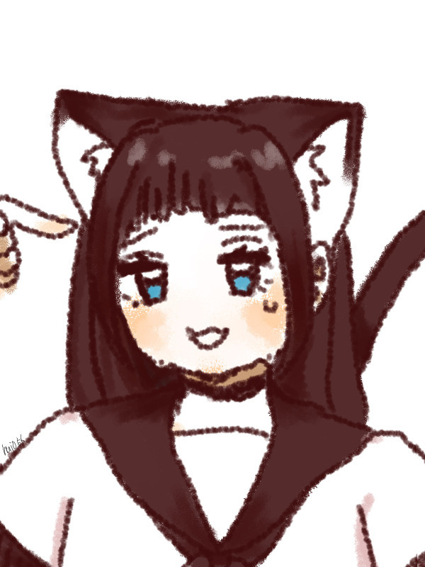
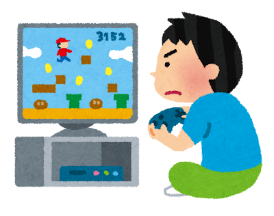

<!-- _class: lead story-title -->

# 分散型SNSのすゝめ

まっちゃてぃー。

<!--
0〜2分。TwitterやInstagramは使うけれど分散型SNSは初めて、という方に向けて話します。好きな話をできる場所をひとつ持ち帰ってほしい。
-->

---

<!-- _class: story profile-slide -->

# 皆さん初めまして 

まっちゃてぃー。

趣味：コーディング、SNS

Misskeyの開発に参加 SNS「まっちゃすきー。」「PrisMisskey」の運営

@mattyatea

<figure><figcaption><b>SNSのアカウント</b> X @mattyatea_</figcaption></figure><figure><figcaption><b>運営しているサービス</b> PrisMisskey</figcaption></figure>

<!--
表紙の次に30〜40秒ほどで自己紹介します。
皆さん、初めまして。まっちゃてぃー。です。
趣味はコーディングとSNSで、Misskeyの開発に参加したり、「まっちゃすきー。」と「PrisMisskey」というSNSを運営したりしています。
Xと、運営しているサービス「PrisMisskey」（prismisskey.space）のQRコードも置いておきます。
今日は使う側として、好きなことを楽しめる場所の話をします。
自己紹介を含めて導入は約2分に収めます。
「本番環境のDBを吹き飛ばした話」2〜4ページと「タイトルページ」2ページを参考にしています。
アイコンは前者の2ページから取り出した本人の既存素材です。
過去の学年・利用者数・投稿数は現在の情報として流用しません。
-->

---

<!-- _class: statement -->

# 何と言っても SNSが大好き

<!--
本人の過去の発表にある言い方。SNSの開発や運営にも関わっていることを短く添えます。
-->

---

<!-- _class: story -->

皆さん、 TwitterとかInstagram 使ってますよね。

<!--
元資料の問いかけと、右側に画面を置く構図を踏襲。今日はSNSを普段使っている方に話しかけます。
-->

---

<!-- _class: story -->

# SNSってこういうことが楽しい

<figure class=""><figcaption>ゲームの話</figcaption></figure><figure class="waiting"><figcaption>創作を見せる</figcaption></figure><figure class="waiting"><figcaption>日常を共有する</figcaption></figure>

<!--
同じ位置にイラストを一つずつ増やします。ゲームの話、作ったものを見せる、日常の写真。皆さんは何を楽しんでますか？三枚合わせて約45秒。
-->

---

<!-- _class: story -->

# SNSってこういうことが楽しい

<figure class=""><figcaption>ゲームの話</figcaption></figure><figure class=""><figcaption>創作を見せる</figcaption></figure><figure class="waiting"><figcaption>日常を共有する</figcaption></figure>

<!--
同じ位置にイラストを一つずつ増やします。ゲームの話、作ったものを見せる、日常の写真。皆さんは何を楽しんでますか？三枚合わせて約45秒。
-->

---

<!-- _class: story -->

# SNSってこういうことが楽しい

<figure class=""><figcaption>ゲームの話</figcaption></figure><figure class=""><figcaption>創作を見せる</figcaption></figure><figure class=""><figcaption>日常を共有する</figcaption></figure>

<!--
同じ位置にイラストを一つずつ増やします。ゲームの話、作ったものを見せる、日常の写真。皆さんは何を楽しんでますか？三枚合わせて約45秒。
-->

---

<!-- _class: statement -->

好きなことって...

# もっと話したいし 色んな人と語り合いたい

<!-- 5〜7枚目の「楽しい」を受けて、聞き手に共感してもらうページ。自分が好きなことって、もっと積極的に話したいし、色んな人と語り合いたいよね。 -->

---

<!-- _class: story everyday -->

# でも いつものSNSだと...

<figure class="viewer"><figcaption>ゲーム好き</figcaption></figure>

いつものSNS

<b>ニュース</b><small>いま</small>

【速報】今日の天気は…

<b>おすすめ</b><small>いま</small>

PR 今だけ半額！

<b>まとめ</b><small>いま</small>

買ってよかったもの10選リンクから

<!-- ニュースだったり、PRだったり、アフィリエイトだったりがたくさん流れてくる。ゲームの話をしている人が見当たらない。 -->

---

<!-- _class: statement -->

ゲームの話がしたいのに...

# 同じ趣味の人が なかなか見つからない

<!-- 今のSNSは何でも流れてくる場所。好きな話をしている人を自分で探すのが大変。 -->

---

<!-- _class: statement -->

しかも...

# 流れてくる話に 疲れることだってある

<!-- ニュースや広告、知らない人の話がずっと流れてくると、好きな話をしに来たのに疲れてしまうこともある。 -->

---

<!-- _class: story everyday -->

# こういうの 見たくないのに流れてくる...

<figure class="viewer"><figcaption>ゲーム好き</figcaption></figure>

いつものSNS

<b>ニュース</b><small>いま</small>

【速報】来月からまた値上げ

<b>まとめ</b><small>いま</small>

【ネタバレ】新作のラスボスの正体は…

<b>知らない人</b><small>いま</small>

そのゲームってもうオワコンでしょ

<!-- 見たくないニュースや話が流れてきて嫌だよね、と共感してもらう。値上げのニュース、まだ遊んでいないゲームのネタバレ、好きなものを悪く言う投稿。どれも架空の投稿例。 -->

---

<!-- _class: statement question-beat -->

じゃあ もし...

# 好きな話だけできる 「別荘」があったら？

<!-- ここで少し間を置く。いつものSNSはそのままで、疲れた時や好きな話をしたい時に行ける場所。この「別荘」という言い方を最後まで使います。 -->

---

<!-- _class: story -->

# 別荘って 好きな場所に建てますよね

<figure class="">

<figcaption>海が好きなら 海沿いに</figcaption></figure><figure class="waiting">

<figcaption>自然が好きなら 山の中に</figcaption></figure><figure class="waiting">

<figcaption>温泉が好きなら 温泉地に</figcaption></figure>

---

<!-- _class: story -->

# 別荘って 好きな場所に建てますよね

<figure class="">

<figcaption>海が好きなら 海沿いに</figcaption></figure><figure class="">

<figcaption>自然が好きなら 山の中に</figcaption></figure><figure class="waiting">

<figcaption>温泉が好きなら 温泉地に</figcaption></figure>

---

<!-- _class: story -->

# 別荘って 好きな場所に建てますよね

<figure class="">

<figcaption>海が好きなら 海沿いに</figcaption></figure><figure class="">

<figcaption>自然が好きなら 山の中に</figcaption></figure><figure class="">

<figcaption>温泉が好きなら 温泉地に</figcaption></figure>

<!-- 別荘のたとえを広げる。海を見るのが好きだから海沿いに建てるし、自然が好きなら山の中にも建てる。好きなものが多ければ、色んなところに別荘を持つよね。 -->

---

<!-- _class: story -->

# SNSの別荘も 好きな事ごとに

<figure class=""><figcaption>ゲームが好きなら ゲーム好きのSNSに</figcaption></figure><figure class="waiting"><figcaption>絵が好きなら お絵描き好きのSNSに</figcaption></figure><figure class="waiting"><figcaption>写真が好きなら 写真好きのSNSに</figcaption></figure>

---

<!-- _class: story -->

# SNSの別荘も 好きな事ごとに

<figure class=""><figcaption>ゲームが好きなら ゲーム好きのSNSに</figcaption></figure><figure class=""><figcaption>絵が好きなら お絵描き好きのSNSに</figcaption></figure><figure class="waiting"><figcaption>写真が好きなら 写真好きのSNSに</figcaption></figure>

---

<!-- _class: story -->

# SNSの別荘も 好きな事ごとに

<figure class=""><figcaption>ゲームが好きなら ゲーム好きのSNSに</figcaption></figure><figure class=""><figcaption>絵が好きなら お絵描き好きのSNSに</figcaption></figure><figure class=""><figcaption>写真が好きなら 写真好きのSNSに</figcaption></figure>

<!-- 前のページと同じ並びで、海や山がSNSに変わる。好きなことが多かったら、別荘はそれぞれ持てばいい。アカウントが増えることは問題にしない。ここでいう「別荘」は、そのSNSのアカウントのことだと口で添える。いつものSNSのアカウントはそのまま残しておけばいい。 -->

---

<!-- _class: story everyday -->

# 例えば ゲーム好きが集まるSNSなら

<figure class="viewer"><figcaption>ゲーム好き</figcaption></figure>

ゲーム好きのSNS

<b>ゆう</b><small>いま</small>

新作の発売日決まった〜！みんな買う？

<b>みお</b><small>いま</small>

ネタバレなしで言うと… ラスト最高だった

<b>はると</b><small>いま</small>

3時間かかったけど ボス倒せた〜！！

<!-- 流れてくるのがゲームの話だけ。さっきのネタバレと違って、ここでは「ネタバレなしで」と気をつかってくれる。楽しそうと思ってもらう。投稿は架空の例。 -->

---

<!-- _class: statement question-beat -->

別荘があるのはいいけど...

# 好きなことが違う 友達とはどうなるの？

<!-- 別荘地を作って行こう、はわかった。でも友達とは好きなものが全部同じとは限らない。ここから具体例へ。 -->

---

<!-- _class: story geography -->

例えば

# AさんとBさんがいます

<b>Aさん</b>ゲームも絵も好き ゲームとお絵描きのSNSに別荘

<b>Bさん</b>ゲームが好き ゲームのSNSに別荘

---

<!-- _class: story geography -->

例えば

# AさんとBさんがいます

<b>Aさん</b>ゲームも絵も好き ゲームとお絵描きのSNSに別荘

<b>Bさん</b>ゲームが好き ゲームのSNSに別荘

<!-- 先に人物を紹介する。Aさんはクリエイターで、ゲームもするし絵も描く。ゲームの話はゲーム好きのSNS、絵はお絵描き好きのSNSと、ちゃんと使い分けている。Bさんはゲーム好きのSNSだけ。 -->

---

<!-- _class: story everyday tl-story -->

# ゲームの話は ゲーム好きのSNSで

<figure class="viewer viewer-pair">

<figcaption><b>Aさん</b>と<b>Bさん</b> ゲーム仲間</figcaption></figure>

ゲーム好きのSNS

タイムライン

<b>Aさん</b><small>いま</small>

新作買った！今からやる

<!-- AさんとBさんはゲーム仲間。ゲームの話はゲーム好きのSNSでしている。ページを送るたびに、タイムラインに二人のゲームの話が流れてくる。 -->

---

<!-- _class: story everyday tl-story -->

# ゲームの話は ゲーム好きのSNSで

<figure class="viewer viewer-pair">

<figcaption><b>Aさん</b>と<b>Bさん</b> ゲーム仲間</figcaption></figure>

ゲーム好きのSNS

タイムライン

<b>Bさん</b><small>いま</small>

新作のボス強すぎない？

<b>Aさん</b><small>いま</small>

新作買った！今からやる

<!-- Bさんの投稿が流れてくる。 -->

---

<!-- _class: story everyday tl-story -->

# ゲームの話は ゲーム好きのSNSで

<figure class="viewer viewer-pair">

<figcaption><b>Aさん</b>と<b>Bさん</b> ゲーム仲間</figcaption></figure>

ゲーム好きのSNS

タイムライン

<b>Aさん</b><small>いま</small>

第二形態で毎回やられる…

<b>Bさん</b><small>いま</small>

新作のボス強すぎない？

<b>Aさん</b><small>いま</small>

新作買った！今からやる

<!-- Aさんが返す。 -->

---

<!-- _class: story everyday tl-story -->

# ゲームの話は ゲーム好きのSNSで

<figure class="viewer viewer-pair">

<figcaption><b>Aさん</b>と<b>Bさん</b> ゲーム仲間</figcaption></figure>

ゲーム好きのSNS

タイムライン

<b>Bさん</b><small>いま</small>

今夜いっしょにやろう！

<b>Aさん</b><small>いま</small>

第二形態で毎回やられる…

<b>Bさん</b><small>いま</small>

新作のボス強すぎない？

<!-- Bさんが誘う。こうやってゲームの話はゲーム好きのSNSで盛り上がっている。 -->

---

<!-- _class: story everyday solo-story -->

# Aさんのタイムライン

<figure class="viewer"><figcaption><b>Aさん</b>のタイムライン</figcaption></figure>

ゲーム好きのSNS

<b>Aさん</b><small>いま</small>

やっとボス倒せた〜！！

<svg aria-hidden="true" data-icon="arrow-back-up" xmlns="http://www.w3.org/2000/svg" width="24" height="24" viewBox="0 0 24 24" fill="none" stroke="currentColor" stroke-width="2" stroke-linecap="round" stroke-linejoin="round" > <path d="M9 14l-4 -4l4 -4" /> <path d="M5 10h11a4 4 0 1 1 0 8h-1" /> </svg><svg aria-hidden="true" data-icon="repeat" xmlns="http://www.w3.org/2000/svg" width="24" height="24" viewBox="0 0 24 24" fill="none" stroke="currentColor" stroke-width="2" stroke-linecap="round" stroke-linejoin="round" > <path d="M4 12v-3a3 3 0 0 1 3 -3h13m-3 -3l3 3l-3 3" /> <path d="M20 12v3a3 3 0 0 1 -3 3h-13m3 3l-3 -3l3 -3" /> </svg><svg aria-hidden="true" data-icon="heart" xmlns="http://www.w3.org/2000/svg" width="24" height="24" viewBox="0 0 24 24" fill="none" stroke="currentColor" stroke-width="2" stroke-linecap="round" stroke-linejoin="round" > <path d="M19.5 12.572l-7.5 7.428l-7.5 -7.428a5 5 0 1 1 7.5 -6.566a5 5 0 1 1 7.5 6.572" /> </svg><svg aria-hidden="true" data-icon="dots" xmlns="http://www.w3.org/2000/svg" width="24" height="24" viewBox="0 0 24 24" fill="none" stroke="currentColor" stroke-width="2" stroke-linecap="round" stroke-linejoin="round" > <path d="M4 12a1 1 0 1 0 2 0a1 1 0 1 0 -2 0" /> <path d="M11 12a1 1 0 1 0 2 0a1 1 0 1 0 -2 0" /> <path d="M18 12a1 1 0 1 0 2 0a1 1 0 1 0 -2 0" /> </svg>

<!-- Aさんの投稿一覧。タイムラインにある内容だけを説明し、次のページの答えは先に言わない。 -->

---

<!-- _class: story everyday solo-story -->

# フォローしているBさんにも もちろん出てきます

<figure class="viewer"><figcaption><b>Bさん</b>のタイムライン</figcaption></figure>

ゲーム好きのSNS

<b>Aさん</b><small>いま</small>

やっとボス倒せた〜！！

<svg aria-hidden="true" data-icon="arrow-back-up" xmlns="http://www.w3.org/2000/svg" width="24" height="24" viewBox="0 0 24 24" fill="none" stroke="currentColor" stroke-width="2" stroke-linecap="round" stroke-linejoin="round" > <path d="M9 14l-4 -4l4 -4" /> <path d="M5 10h11a4 4 0 1 1 0 8h-1" /> </svg><svg aria-hidden="true" data-icon="repeat" xmlns="http://www.w3.org/2000/svg" width="24" height="24" viewBox="0 0 24 24" fill="none" stroke="currentColor" stroke-width="2" stroke-linecap="round" stroke-linejoin="round" > <path d="M4 12v-3a3 3 0 0 1 3 -3h13m-3 -3l3 3l-3 3" /> <path d="M20 12v3a3 3 0 0 1 -3 3h-13m3 3l-3 -3l3 -3" /> </svg><svg aria-hidden="true" data-icon="heart" xmlns="http://www.w3.org/2000/svg" width="24" height="24" viewBox="0 0 24 24" fill="none" stroke="currentColor" stroke-width="2" stroke-linecap="round" stroke-linejoin="round" > <path d="M19.5 12.572l-7.5 7.428l-7.5 -7.428a5 5 0 1 1 7.5 -6.566a5 5 0 1 1 7.5 6.572" /> </svg><svg aria-hidden="true" data-icon="dots" xmlns="http://www.w3.org/2000/svg" width="24" height="24" viewBox="0 0 24 24" fill="none" stroke="currentColor" stroke-width="2" stroke-linecap="round" stroke-linejoin="round" > <path d="M4 12a1 1 0 1 0 2 0a1 1 0 1 0 -2 0" /> <path d="M11 12a1 1 0 1 0 2 0a1 1 0 1 0 -2 0" /> <path d="M18 12a1 1 0 1 0 2 0a1 1 0 1 0 -2 0" /> </svg>

<!-- Bさんのホーム。タイムラインにある内容だけを説明し、次のページの答えは先に言わない。 -->

---

<!-- _class: statement -->

でも Bさんは...

# Aさんが描いている絵も 見たい！

<!-- ゲームの話はゲーム好きのSNSでできる。でもBさんは、Aさんが描いている絵も見たい。 -->

---

<!-- _class: story everyday solo-story -->

# でも Aさんの絵は お絵描きの別荘に

<figure class="viewer"><figcaption><b>Aさん</b>のタイムライン</figcaption></figure>

お絵描き好きのSNS

<b>Aさん</b><small>いま</small>

今日描いた絵、見て〜！

<svg aria-hidden="true" data-icon="arrow-back-up" xmlns="http://www.w3.org/2000/svg" width="24" height="24" viewBox="0 0 24 24" fill="none" stroke="currentColor" stroke-width="2" stroke-linecap="round" stroke-linejoin="round" > <path d="M9 14l-4 -4l4 -4" /> <path d="M5 10h11a4 4 0 1 1 0 8h-1" /> </svg><svg aria-hidden="true" data-icon="repeat" xmlns="http://www.w3.org/2000/svg" width="24" height="24" viewBox="0 0 24 24" fill="none" stroke="currentColor" stroke-width="2" stroke-linecap="round" stroke-linejoin="round" > <path d="M4 12v-3a3 3 0 0 1 3 -3h13m-3 -3l3 3l-3 3" /> <path d="M20 12v3a3 3 0 0 1 -3 3h-13m3 3l-3 -3l3 -3" /> </svg><svg aria-hidden="true" data-icon="heart" xmlns="http://www.w3.org/2000/svg" width="24" height="24" viewBox="0 0 24 24" fill="none" stroke="currentColor" stroke-width="2" stroke-linecap="round" stroke-linejoin="round" > <path d="M19.5 12.572l-7.5 7.428l-7.5 -7.428a5 5 0 1 1 7.5 -6.566a5 5 0 1 1 7.5 6.572" /> </svg><svg aria-hidden="true" data-icon="dots" xmlns="http://www.w3.org/2000/svg" width="24" height="24" viewBox="0 0 24 24" fill="none" stroke="currentColor" stroke-width="2" stroke-linecap="round" stroke-linejoin="round" > <path d="M4 12a1 1 0 1 0 2 0a1 1 0 1 0 -2 0" /> <path d="M11 12a1 1 0 1 0 2 0a1 1 0 1 0 -2 0" /> <path d="M18 12a1 1 0 1 0 2 0a1 1 0 1 0 -2 0" /> </svg>

<!-- Aさんは描いた絵をお絵描き好きのSNSにアップロードして、ちゃんと使い分けている。でもAさんも、ゲーム仲間に「いいから見てよ」と絵を見てほしい。タイムラインにある内容だけを説明し、次のページの答えは先に言わない。 -->

---

<!-- _class: statement question-beat -->

この絵を見るには...

# Bさんも お絵描きのSNSに 別荘を建てなきゃだめ？

<!-- この問いで止める。他の人の別荘を見るために、その別荘地に自分もアカウントを作らなきゃいけないのか。聞き手が考えてから次の画面へ進む。 -->

---

<!-- _class: story everyday solo-story -->

# 建てなくても Bさんのタイムラインに届きます

<figure class="viewer"><figcaption><b>Bさん</b>のタイムライン</figcaption></figure>

ゲーム好きのSNS

<b>Aさん</b><small>いま</small>

今日描いた絵、見て〜！

<svg aria-hidden="true" data-icon="arrow-back-up" xmlns="http://www.w3.org/2000/svg" width="24" height="24" viewBox="0 0 24 24" fill="none" stroke="currentColor" stroke-width="2" stroke-linecap="round" stroke-linejoin="round" > <path d="M9 14l-4 -4l4 -4" /> <path d="M5 10h11a4 4 0 1 1 0 8h-1" /> </svg><svg aria-hidden="true" data-icon="repeat" xmlns="http://www.w3.org/2000/svg" width="24" height="24" viewBox="0 0 24 24" fill="none" stroke="currentColor" stroke-width="2" stroke-linecap="round" stroke-linejoin="round" > <path d="M4 12v-3a3 3 0 0 1 3 -3h13m-3 -3l3 3l-3 3" /> <path d="M20 12v3a3 3 0 0 1 -3 3h-13m3 3l-3 -3l3 -3" /> </svg><svg aria-hidden="true" data-icon="heart" xmlns="http://www.w3.org/2000/svg" width="24" height="24" viewBox="0 0 24 24" fill="none" stroke="currentColor" stroke-width="2" stroke-linecap="round" stroke-linejoin="round" > <path d="M19.5 12.572l-7.5 7.428l-7.5 -7.428a5 5 0 1 1 7.5 -6.566a5 5 0 1 1 7.5 6.572" /> </svg><svg aria-hidden="true" data-icon="dots" xmlns="http://www.w3.org/2000/svg" width="24" height="24" viewBox="0 0 24 24" fill="none" stroke="currentColor" stroke-width="2" stroke-linecap="round" stroke-linejoin="round" > <path d="M4 12a1 1 0 1 0 2 0a1 1 0 1 0 -2 0" /> <path d="M11 12a1 1 0 1 0 2 0a1 1 0 1 0 -2 0" /> <path d="M18 12a1 1 0 1 0 2 0a1 1 0 1 0 -2 0" /> </svg>

<!-- BさんのSNSには登録済みでAさんをフォローしている。タイムラインにある内容だけを説明し、次のページの答えは先に言わない。 -->

---

<!-- _class: statement question-beat -->

別荘が違うのに...

# どういうこと？

<!-- 前のページで届いたのを見せたあと、聞き手の「なんで？」をここで受ける。ここからが面白いところ。答えは次の画面で見せる。 -->

---

<!-- _class: statement question-beat -->

手紙に例えてみましょう

# 皆さん 手紙って 書いたことありますか？

<!-- 聞き手に問いかけて、身近な手紙の話から入る。答えを待ってから次へ。 -->

---

<!-- _class: story letter-slide -->

# 手紙は 住所を知っていれば届きますよね

<b>Aさん</b>

<b>ポスト</b>

<b>Bさんの家</b>

<small>Bさんの住所</small>

<small>宛先：Bさんの住所</small>

<small>宛先：Aさんの住所</small>

① Aさんが Bさんの住所を確認する

② Aさんが その住所に 手紙を出す

<!-- 先にAさんがBさんの住所を確認して、だからその住所に手紙を出せる、という順番で見せる。住所のカードがBさんの家からAさんへ移り、そのあと手紙がポストを通ってBさんの郵便受けに届く。そのあとは返事が届いて、手紙の行き来がずっと続く。 -->

---

<!-- _class: statement recap -->

# 分散型SNSに 置き換えると

フォローする ＝ 住所を教える

投稿する ＝ 手紙を出す

<!-- フォローは「私の住所はここだよ」と相手に教えること。 -->

---

<!-- _class: statement recap -->

# 分散型SNSに 置き換えると

フォローする ＝ 住所を教える

投稿する ＝ 手紙を出す

<!-- 手紙の②と同じ。投稿すると、教えてもらった住所へ届けてもらえる。次の図で同じ順番を確かめる。 -->

---

<!-- _class: delivery follow-address -->
<!-- _transition: matcha 600ms -->

# ① Bさんが フォローすると...

ゲーム好きのSNS
Bさん
<small>タイムライン</small>

お絵描き好きのSNS
Aさん
<small>投稿一覧</small>

フォロー <small>住所：ゲーム好きのSNS</small>

フォロワー <b>Bさん（ゲーム好きのSNS）</b>

Bさんの住所が Aさんの別荘に伝わる

<!-- フォローは「私の住所はここだよ」と相手に教えること。BさんのフォローがAさんのいるお絵描き好きのSNSに届いて、フォロワーとして住所が残る。 -->

---

<!-- _class: delivery write -->
<!-- _transition: matcha 600ms -->

# ② Aさんが 投稿すると...

ゲーム好きのSNS
Bさん
<small>タイムライン</small>

お絵描き好きのSNS
Aさん
<small>フォロワーにBさん</small>

<small>Aさん</small> <b>今日描いた絵、見て〜！</b>

<!-- 元の投稿は残る。フォローや接続、公開範囲が許す場合。 -->

---

<!-- _class: delivery deliver -->
<!-- _transition: matcha 600ms -->

# 教えてもらった住所へ届ける

ゲーム好きのSNS
Bさん
<small>タイムライン</small>

お絵描き好きのSNS
Aさん
<small>フォロワーにBさん</small>

← 投稿が届く

<small>Aさん</small> <b>今日描いた絵、見て〜！</b>

<small>Aさん</small> <b>今日描いた絵、見て〜！</b>

Bさんの ゲーム好きのSNSに届く

<!-- 元の投稿はAさんのSNSに残り、コピーがBさんのSNSへ飛んでいく。フォローや接続、公開範囲が許す場合。 -->

---

<!-- _class: statement -->

手紙が届くのは 郵便のルールが共通だから

# 別荘同士も 同じルールで繋がっている

<!-- 住所の書き方や郵便の仕組みが共通だから、どこからでも手紙が届く。SNS同士も同じルール（ActivityPub）で話せるから、投稿を受け渡しできる。ルールの名前は後で出てくる。ただし、TwitterとInstagramみたいに、どんなSNSでも繋がるわけではない。繋がれるSNS同士の話。 -->

---

<!-- _class: story everyday solo-story -->

# Bさんが ハートを押すと...

<figure class="viewer"><figcaption><b>Bさん</b>のタイムライン</figcaption></figure>

ゲーム好きのSNS

<b>Aさん</b><small>いま</small>

今日描いた絵、見て〜！

<svg aria-hidden="true" data-icon="arrow-back-up" xmlns="http://www.w3.org/2000/svg" width="24" height="24" viewBox="0 0 24 24" fill="none" stroke="currentColor" stroke-width="2" stroke-linecap="round" stroke-linejoin="round" > <path d="M9 14l-4 -4l4 -4" /> <path d="M5 10h11a4 4 0 1 1 0 8h-1" /> </svg><svg aria-hidden="true" data-icon="repeat" xmlns="http://www.w3.org/2000/svg" width="24" height="24" viewBox="0 0 24 24" fill="none" stroke="currentColor" stroke-width="2" stroke-linecap="round" stroke-linejoin="round" > <path d="M4 12v-3a3 3 0 0 1 3 -3h13m-3 -3l3 3l-3 3" /> <path d="M20 12v3a3 3 0 0 1 -3 3h-13m3 3l-3 -3l3 -3" /> </svg><svg aria-hidden="true" data-icon="heart" xmlns="http://www.w3.org/2000/svg" width="24" height="24" viewBox="0 0 24 24" fill="none" stroke="currentColor" stroke-width="2" stroke-linecap="round" stroke-linejoin="round" > <path d="M19.5 12.572l-7.5 7.428l-7.5 -7.428a5 5 0 1 1 7.5 -6.566a5 5 0 1 1 7.5 6.572" /> </svg><svg aria-hidden="true" data-icon="dots" xmlns="http://www.w3.org/2000/svg" width="24" height="24" viewBox="0 0 24 24" fill="none" stroke="currentColor" stroke-width="2" stroke-linecap="round" stroke-linejoin="round" > <path d="M4 12a1 1 0 1 0 2 0a1 1 0 1 0 -2 0" /> <path d="M11 12a1 1 0 1 0 2 0a1 1 0 1 0 -2 0" /> <path d="M18 12a1 1 0 1 0 2 0a1 1 0 1 0 -2 0" /> </svg>

<!-- Bさんのゲーム好きのSNSに届いたAさんの絵。ハートのボタンを押す。 -->

---

<!-- _class: story everyday solo-story -->

# Bさんが ハートを押すと...

<figure class="viewer"><figcaption><b>Bさん</b>のタイムライン</figcaption></figure>

ゲーム好きのSNS

<b>Aさん</b><small>いま</small>

今日描いた絵、見て〜！

<svg aria-hidden="true" data-icon="arrow-back-up" xmlns="http://www.w3.org/2000/svg" width="24" height="24" viewBox="0 0 24 24" fill="none" stroke="currentColor" stroke-width="2" stroke-linecap="round" stroke-linejoin="round" > <path d="M9 14l-4 -4l4 -4" /> <path d="M5 10h11a4 4 0 1 1 0 8h-1" /> </svg><svg aria-hidden="true" data-icon="repeat" xmlns="http://www.w3.org/2000/svg" width="24" height="24" viewBox="0 0 24 24" fill="none" stroke="currentColor" stroke-width="2" stroke-linecap="round" stroke-linejoin="round" > <path d="M4 12v-3a3 3 0 0 1 3 -3h13m-3 -3l3 3l-3 3" /> <path d="M20 12v3a3 3 0 0 1 -3 3h-13m3 3l-3 -3l3 -3" /> </svg><svg aria-hidden="true" data-icon="heart" xmlns="http://www.w3.org/2000/svg" width="24" height="24" viewBox="0 0 24 24" fill="none" stroke="currentColor" stroke-width="2" stroke-linecap="round" stroke-linejoin="round" > <path d="M19.5 12.572l-7.5 7.428l-7.5 -7.428a5 5 0 1 1 7.5 -6.566a5 5 0 1 1 7.5 6.572" /> </svg><svg aria-hidden="true" data-icon="dots" xmlns="http://www.w3.org/2000/svg" width="24" height="24" viewBox="0 0 24 24" fill="none" stroke="currentColor" stroke-width="2" stroke-linecap="round" stroke-linejoin="round" > <path d="M4 12a1 1 0 1 0 2 0a1 1 0 1 0 -2 0" /> <path d="M11 12a1 1 0 1 0 2 0a1 1 0 1 0 -2 0" /> <path d="M18 12a1 1 0 1 0 2 0a1 1 0 1 0 -2 0" /> </svg>

<!-- ハートに色が付く。いつものSNSと同じ操作。 -->

---

<!-- _class: story everyday solo-story -->

# いいねなどの反応も Aさんに届きます

<figure class="viewer"><figcaption><b>Aさん</b>のタイムライン</figcaption></figure>

お絵描き好きのSNS

<b>Aさん</b><small>いま</small>

今日描いた絵、見て〜！

<svg aria-hidden="true" data-icon="arrow-back-up" xmlns="http://www.w3.org/2000/svg" width="24" height="24" viewBox="0 0 24 24" fill="none" stroke="currentColor" stroke-width="2" stroke-linecap="round" stroke-linejoin="round" > <path d="M9 14l-4 -4l4 -4" /> <path d="M5 10h11a4 4 0 1 1 0 8h-1" /> </svg><svg aria-hidden="true" data-icon="repeat" xmlns="http://www.w3.org/2000/svg" width="24" height="24" viewBox="0 0 24 24" fill="none" stroke="currentColor" stroke-width="2" stroke-linecap="round" stroke-linejoin="round" > <path d="M4 12v-3a3 3 0 0 1 3 -3h13m-3 -3l3 3l-3 3" /> <path d="M20 12v3a3 3 0 0 1 -3 3h-13m3 3l-3 -3l3 -3" /> </svg><svg aria-hidden="true" data-icon="heart" xmlns="http://www.w3.org/2000/svg" width="24" height="24" viewBox="0 0 24 24" fill="none" stroke="currentColor" stroke-width="2" stroke-linecap="round" stroke-linejoin="round" > <path d="M19.5 12.572l-7.5 7.428l-7.5 -7.428a5 5 0 1 1 7.5 -6.566a5 5 0 1 1 7.5 6.572" /> </svg><b>1</b><i class="plus-one">+1</i><svg aria-hidden="true" data-icon="dots" xmlns="http://www.w3.org/2000/svg" width="24" height="24" viewBox="0 0 24 24" fill="none" stroke="currentColor" stroke-width="2" stroke-linecap="round" stroke-linejoin="round" > <path d="M4 12a1 1 0 1 0 2 0a1 1 0 1 0 -2 0" /> <path d="M11 12a1 1 0 1 0 2 0a1 1 0 1 0 -2 0" /> <path d="M18 12a1 1 0 1 0 2 0a1 1 0 1 0 -2 0" /> </svg>

<b>Bさんがいいねしました</b><small>ゲーム好きのSNSから</small>
<svg aria-hidden="true" xmlns="http://www.w3.org/2000/svg" width="24" height="24" viewBox="0 0 24 24" fill="currentColor" stroke="currentColor" stroke-width="2" stroke-linecap="round" stroke-linejoin="round"><path d="M19.5 12.572l-7.5 7.428l-7.5 -7.428a5 5 0 1 1 7.5 -6.566a5 5 0 1 1 7.5 6.572" /></svg>

<!-- Bさんのいいねが、お絵描き好きのSNSにいるAさんのタイムラインに届いた。別荘が違っても、いいねまでちゃんと届く。ハートの数が+1されて、右下に「Bさんがいいねしました」の通知が届く。いいね以外の反応も同じように届く。 -->

---

<!-- _class: statement -->

投稿も いいねも届くから...

# 好きな別荘にいても 色んな人と話せる

<!-- ここまでで投稿も返信もいいねも、別荘を越えて届くことを見た。だから好きな別荘にいても、色んな人と話せる仕組みになっている。 -->

---

<!-- _class: story network-slide -->

# 実際にはこんなにたくさん

<svg viewBox="0 0 1096 510" aria-hidden="true"><g class="network-links"><path d="M190 140 Q365.0 155.0 540 250"/><path d="M540 250 Q715.0 130.0 890 90"/><path d="M190 140 Q195.0 235.0 200 410"/><path d="M200 410 Q370.0 290.0 540 250"/><path d="M540 250 Q715.0 290.0 890 410"/><path d="M890 90 Q890.0 210.0 890 410"/></g></svg>
<b>ゲーム好きのSNS</b>  

<b>創作のSNS</b>  

<b>日常を話すSNS</b>  

<b>音楽好きのSNS</b>  

<b>地域のSNS</b>  
<svg aria-hidden="true" data-icon="mail" xmlns="http://www.w3.org/2000/svg" width="24" height="24" viewBox="0 0 24 24" fill="none" stroke="currentColor" stroke-width="2" stroke-linecap="round" stroke-linejoin="round" > <path d="M3 7a2 2 0 0 1 2 -2h14a2 2 0 0 1 2 2v10a2 2 0 0 1 -2 2h-14a2 2 0 0 1 -2 -2v-10" /> <path d="M3 7l9 6l9 -6" /> </svg><svg aria-hidden="true" data-icon="mail" xmlns="http://www.w3.org/2000/svg" width="24" height="24" viewBox="0 0 24 24" fill="none" stroke="currentColor" stroke-width="2" stroke-linecap="round" stroke-linejoin="round" > <path d="M3 7a2 2 0 0 1 2 -2h14a2 2 0 0 1 2 2v10a2 2 0 0 1 -2 2h-14a2 2 0 0 1 -2 -2v-10" /> <path d="M3 7l9 6l9 -6" /> </svg><svg aria-hidden="true" data-icon="mail" xmlns="http://www.w3.org/2000/svg" width="24" height="24" viewBox="0 0 24 24" fill="none" stroke="currentColor" stroke-width="2" stroke-linecap="round" stroke-linejoin="round" > <path d="M3 7a2 2 0 0 1 2 -2h14a2 2 0 0 1 2 2v10a2 2 0 0 1 -2 2h-14a2 2 0 0 1 -2 -2v-10" /> <path d="M3 7l9 6l9 -6" /> </svg><svg aria-hidden="true" data-icon="mail" xmlns="http://www.w3.org/2000/svg" width="24" height="24" viewBox="0 0 24 24" fill="none" stroke="currentColor" stroke-width="2" stroke-linecap="round" stroke-linejoin="round" > <path d="M3 7a2 2 0 0 1 2 -2h14a2 2 0 0 1 2 2v10a2 2 0 0 1 -2 2h-14a2 2 0 0 1 -2 -2v-10" /> <path d="M3 7l9 6l9 -6" /> </svg><svg aria-hidden="true" data-icon="mail" xmlns="http://www.w3.org/2000/svg" width="24" height="24" viewBox="0 0 24 24" fill="none" stroke="currentColor" stroke-width="2" stroke-linecap="round" stroke-linejoin="round" > <path d="M3 7a2 2 0 0 1 2 -2h14a2 2 0 0 1 2 2v10a2 2 0 0 1 -2 2h-14a2 2 0 0 1 -2 -2v-10" /> <path d="M3 7l9 6l9 -6" /> </svg><svg aria-hidden="true" data-icon="mail" xmlns="http://www.w3.org/2000/svg" width="24" height="24" viewBox="0 0 24 24" fill="none" stroke="currentColor" stroke-width="2" stroke-linecap="round" stroke-linejoin="round" > <path d="M3 7a2 2 0 0 1 2 -2h14a2 2 0 0 1 2 2v10a2 2 0 0 1 -2 2h-14a2 2 0 0 1 -2 -2v-10" /> <path d="M3 7l9 6l9 -6" /> </svg>

<svg aria-hidden="true" data-icon="mail" xmlns="http://www.w3.org/2000/svg" width="24" height="24" viewBox="0 0 24 24" fill="none" stroke="currentColor" stroke-width="2" stroke-linecap="round" stroke-linejoin="round" > <path d="M3 7a2 2 0 0 1 2 -2h14a2 2 0 0 1 2 2v10a2 2 0 0 1 -2 2h-14a2 2 0 0 1 -2 -2v-10" /> <path d="M3 7l9 6l9 -6" /> </svg> 投稿や返信が繋がった相手のいるSNSへ

<!--
20〜30秒ほど図を見せながら説明。線はやり取りの例です。投稿や返信が、フォローなどの繋がりに応じて別のSNSへ届きます。全部の投稿が全員に届くという意味ではありません。SNSの名前や組み合わせは架空です。投稿や返信が繰り返し流れます。
-->

---

<!-- _class: statement -->

別々に運営されているSNSが繋がっている

# これが「分散型SNS」

<!--
図で見たことに名前を付けるだけのページにします。中央のひとつの運営元が全部を運営しているのではなく、それぞれの運営元のSNSがやり取りします。
-->

---

<!-- _class: statement recap -->

# ここまでのおさらい

好きな事ごとに「別荘」を持てる

別荘が違っても フォローすれば投稿が届く

返信やいいねも 別荘を越えて届く

別荘同士は 共通のルールで繋がっている

<!-- ここまでが分散型SNSの説明。1ページに1つずつ足しながら振り返る。 -->

---

<!-- _class: statement recap -->

# ここまでのおさらい

好きな事ごとに「別荘」を持てる

別荘が違っても フォローすれば投稿が届く

返信やいいねも 別荘を越えて届く

別荘同士は 共通のルールで繋がっている

<!-- ここまでが分散型SNSの説明。1ページに1つずつ足しながら振り返る。 -->

---

<!-- _class: statement recap -->

# ここまでのおさらい

好きな事ごとに「別荘」を持てる

別荘が違っても フォローすれば投稿が届く

返信やいいねも 別荘を越えて届く

別荘同士は 共通のルールで繋がっている

<!-- ここまでが分散型SNSの説明。1ページに1つずつ足しながら振り返る。 -->

---

<!-- _class: statement recap -->

# ここまでのおさらい

好きな事ごとに「別荘」を持てる

別荘が違っても フォローすれば投稿が届く

返信やいいねも 別荘を越えて届く

別荘同士は 共通のルールで繋がっている

<!-- ここまでが分散型SNSの説明。1ページに1つずつ足しながら振り返る。 -->

---

<!-- _class: lead story-title -->

分散型SNSのすゝめ 後半

# Misskeyのすゝめ

まっちゃてぃー。

<!-- ここからはMisskeyのおすすめ。タイトルコールのあと休憩を挟む。休憩中もこのページのまま。 -->

---

<!-- _class: statement question-beat -->

# Misskeyって なに？

<!-- ここで問いかけて、次のページで答える。 -->

---

<!-- _class: statement -->

さっきの共通のルールを使った

# 好きな人が 好きなように 立てられるSNSの一つ

<!-- Misskeyは、さっきの共通のルールで繋がれるSNSのアプリ。Twitterみたいなアプリを、色んな人が自分で立てて運営している。 -->

---

<!-- _class: statement -->

例えるなら...

# Discordのサーバーみたいに 好きなサーバーを立てられる

<!-- 一番わかりやすいのはDiscordのサーバー。好きなテーマのサーバーを自分で作れる。 -->

---

<!-- _class: statement -->

Discordより ちょっと大変だけど...

# 同じルールのSNSなら どことでも繋がれる

<!-- 立てるのはDiscordよりハードルが高い。でも同じ仕組みを使っていれば、アプリが違ってもやり取りできる。 -->

---

<!-- _class: story geography -->

# 住所に例えるとこうなります

<b>ActivityPub 国 <small>共通のルールでやり取り</small></b>

<b>Misskey 県</b>

<b>ゲーム市</b>Aさん・Bさん

<b>お絵描き市</b>Aさん

↔

<b>Mastodon 県</b>

<b>音楽市</b>Cさん

県はアプリの違い　市は特色の違い 県が違っても同じ国なら話せます

<!-- 国が共通のルール（ActivityPub）、県がアプリ（MisskeyやMastodon）、市がサーバー（ゲーム好き・お絵描き好きなど特色の違い）。MisskeyとMastodonは別のソフトウェアですが、ActivityPubという共通の通信ルールに対応しています。市名は架空です。 -->

---

<!-- _class: statement question-beat -->

いいねだけだと物足りない？

# もっと「すごい！」を 伝えるには？

<!-- ここで止める。答えは次の絵文字での反応。 -->

---

<!-- _class: story -->

# 絵文字でも返せます

これができるのが「Misskey」

<b>Aさん</b><small>お絵描き好きのSNS</small>
いま

今日描いた絵、見て〜！

321111

<svg aria-hidden="true" data-icon="arrow-back-up" xmlns="http://www.w3.org/2000/svg" width="24" height="24" viewBox="0 0 24 24" fill="none" stroke="currentColor" stroke-width="2" stroke-linecap="round" stroke-linejoin="round" > <path d="M9 14l-4 -4l4 -4" /> <path d="M5 10h11a4 4 0 1 1 0 8h-1" /> </svg><svg aria-hidden="true" data-icon="repeat" xmlns="http://www.w3.org/2000/svg" width="24" height="24" viewBox="0 0 24 24" fill="none" stroke="currentColor" stroke-width="2" stroke-linecap="round" stroke-linejoin="round" > <path d="M4 12v-3a3 3 0 0 1 3 -3h13m-3 -3l3 3l-3 3" /> <path d="M20 12v3a3 3 0 0 1 -3 3h-13m3 3l-3 -3l3 -3" /> </svg><svg aria-hidden="true" data-icon="plus" xmlns="http://www.w3.org/2000/svg" width="24" height="24" viewBox="0 0 24 24" fill="none" stroke="currentColor" stroke-width="2" stroke-linecap="round" stroke-linejoin="round" > <path d="M12 5l0 14" /> <path d="M5 12l14 0" /> </svg><svg aria-hidden="true" data-icon="dots" xmlns="http://www.w3.org/2000/svg" width="24" height="24" viewBox="0 0 24 24" fill="none" stroke="currentColor" stroke-width="2" stroke-linecap="round" stroke-linejoin="round" > <path d="M4 12a1 1 0 1 0 2 0a1 1 0 1 0 -2 0" /> <path d="M11 12a1 1 0 1 0 2 0a1 1 0 1 0 -2 0" /> <path d="M18 12a1 1 0 1 0 2 0a1 1 0 1 0 -2 0" /> </svg>

<!--
同じ投稿に絵文字の反応が増えます。おめでとう、すごい、好き。文字を書かなくても反応できます。すべての分散型SNSで同じ機能になるわけではありません。
-->

---

<!-- _class: story -->

# 自分ならどこに別荘を建てたいですか？

ゲームの話？　絵の話？　日常の話？

<!--
機械の詳しい説明はしません。さっきの図の一つ一つのSNSが、ここで言うサーバーです。住所のたとえの「市」に別荘を建てるイメージです。MisskeyはSNSを作るソフトウェアの名前で、登録先は複数あります。
-->

---

<!-- _class: statement recap -->

# つまり...

居心地のいい場所を選べる

別の場所の人とも繋がれる

<!-- 最初の一つを覚えてもらいます。 -->

---

<!-- _class: statement recap -->

# つまり...

居心地のいい場所を選べる

別の場所の人とも繋がれる

<!-- 二つ目を同じ構図に足します。 -->

---

<!-- _class: story -->

# 皆さんなら何を投稿しますか？

<figure class=""><figcaption>「このボス倒せた！」</figcaption></figure><figure class="waiting"><figcaption>「今日描いた絵！」</figcaption></figure><figure class="waiting"><figcaption>「今日の空よくない？」</figcaption></figure>

---

<!-- _class: story -->

# 皆さんなら何を投稿しますか？

<figure class=""><figcaption>「このボス倒せた！」</figcaption></figure><figure class=""><figcaption>「今日描いた絵！」</figcaption></figure><figure class="waiting"><figcaption>「今日の空よくない？」</figcaption></figure>

---

<!-- _class: story -->

# 皆さんなら何を投稿しますか？

<figure class=""><figcaption>「このボス倒せた！」</figcaption></figure><figure class=""><figcaption>「今日描いた絵！」</figcaption></figure><figure class=""><figcaption>「今日の空よくない？」</figcaption></figure>

<!--
冒頭の趣味を思い出してもらいます。このゲームのあの場面が好き、絵を見てほしい、写真を見せたい。本人の実体験としては語らず、楽しみ方の例として紹介します。
-->

---

<!-- _class: story everyday compare-story -->

# あなたの心地いい方へ

ゲームの話で賑やか

「新作もう遊んだ？」

「あのボス倒せた〜！」

「攻略の話聞きたい！」

日常の話をのんびり

「今日の空綺麗だった」

「少しずつ絵を描いてる」

「今日は早めに寝よう」

賑やかでも のんびりでも 選ぶのはあなた

<!-- 架空の投稿例。実在するSNSの雰囲気や利用者の発言を引用したものではない。 -->

---

<!-- _class: statement -->

ここが一番難しくて 一番楽しいところ

# どこに住むかは 皆さんが選べる

<!-- さっきから質問しているのは、皆さんが自分で選べるから。 -->

---

<!-- _class: statement -->

選びたい場所がなかったら...

# 自分で 立てればいい

<!-- ぴったりの場所がなければ、自分でサーバーを立てることもできる。 -->

---

<!-- _class: statement -->

そんな面白い世界が

# 分散型SNS

<!-- ここまでの話をまとめる一言。 -->

---

<!-- _class: statement -->

# 皆さんにも 「好き」を楽しんでほしい

<!--
本人が今回明言した目的です。好きな話をして、反応をもらう。それを楽しく続けられる場所を探してほしい。
-->

---

<!-- _class: statement -->

別荘で

# 自分の「好き」を 思いっきり楽しもう

<!--
19分で締め、残り1分は進行の余裕とします。ありがとうございました。
-->

---

<!-- _class: story references -->

# 参考資料

[Misskeyをはじめよう](https://misskey-hub.net/ja/docs/for-users/onboarding/)

[MisskeyとMisskeyサーバー](https://misskey-hub.net/ja/docs/misskey-and-misskey-servers/)

[分散型SNS、Misskeyって何？](https://nanasi-apps.xyz/posts/What-is-Misskey/)

イラスト　[いらすとや](https://www.irasutoya.com/)

絵文字　[Twemoji](https://github.com/twitter/twemoji) — Twitter, Inc. and other contributors / [CC BY 4.0](https://creativecommons.org/licenses/by/4.0/)

<!--
本編には含めない参考資料。素材の個別出典はnotes/visual-assets.html。投稿例は架空で、実ユーザーからの引用はありません。
-->

---

<!-- _class: lead story-title closing -->

# ご清聴ありがとうございました

まっちゃてぃー。

<!-- 最後に一礼。質問があればこのページのまま受ける。 -->
